# LCD Display 16x02 via I2C
## Clock configurations
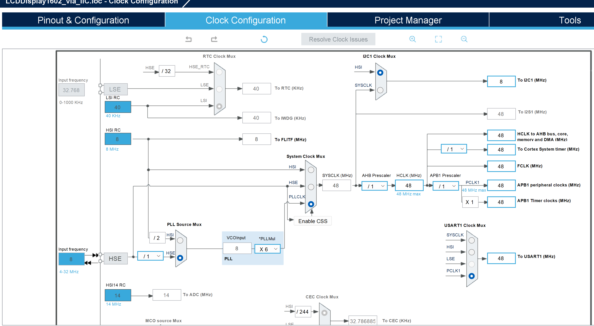
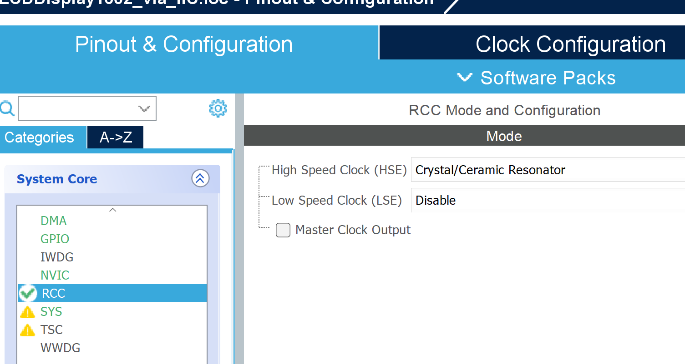

## MCU and GPIOs
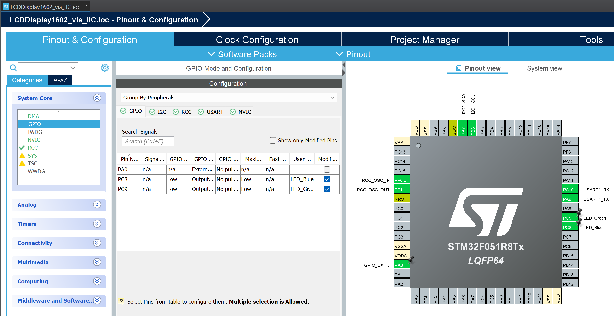

## NVICs
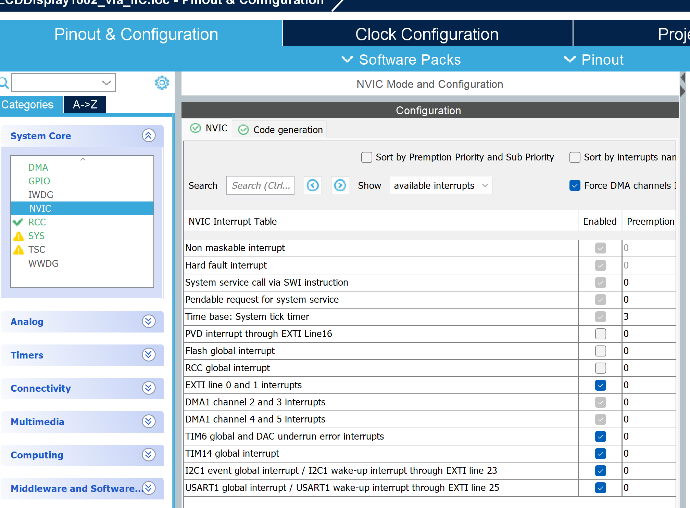

## Timers
Timers clock sources with frequencies can be seen in [Clock source](#clock-configurations).

### TIM6
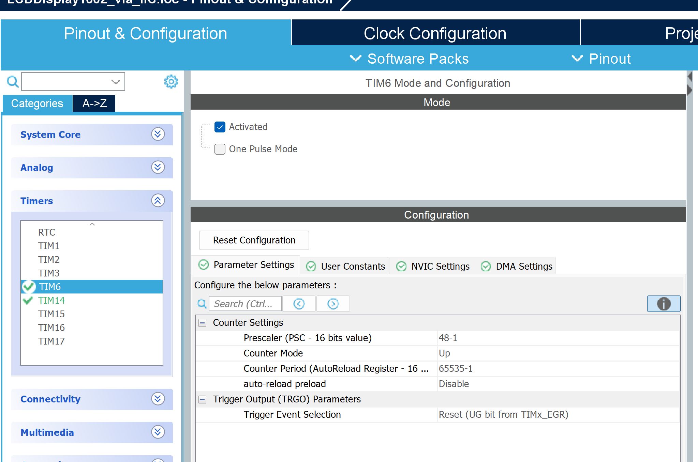
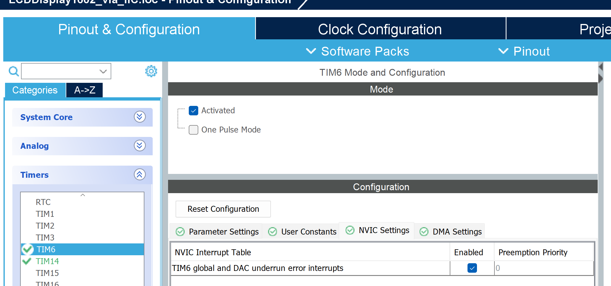

### TIM14
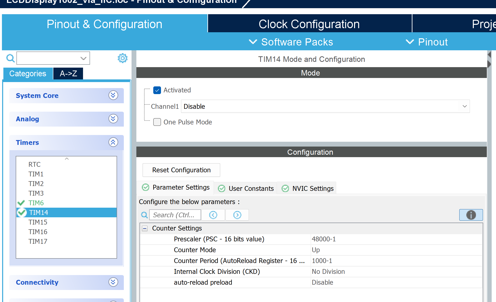
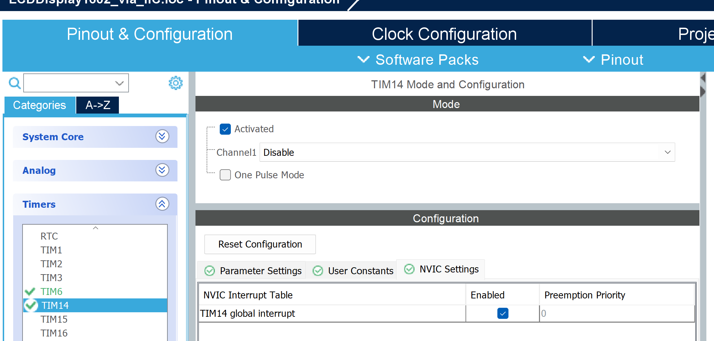

### UART
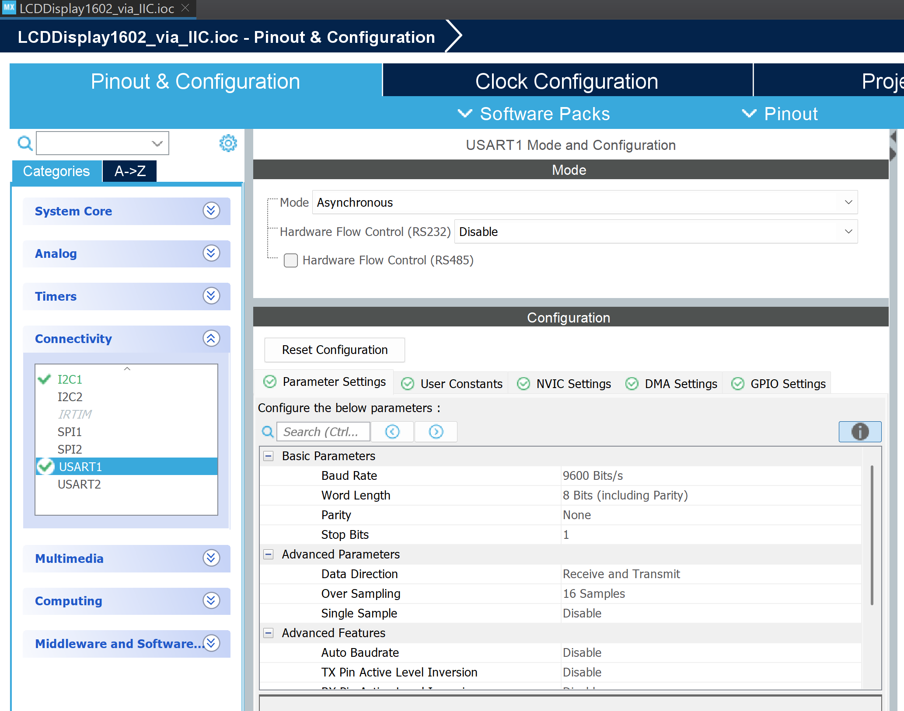
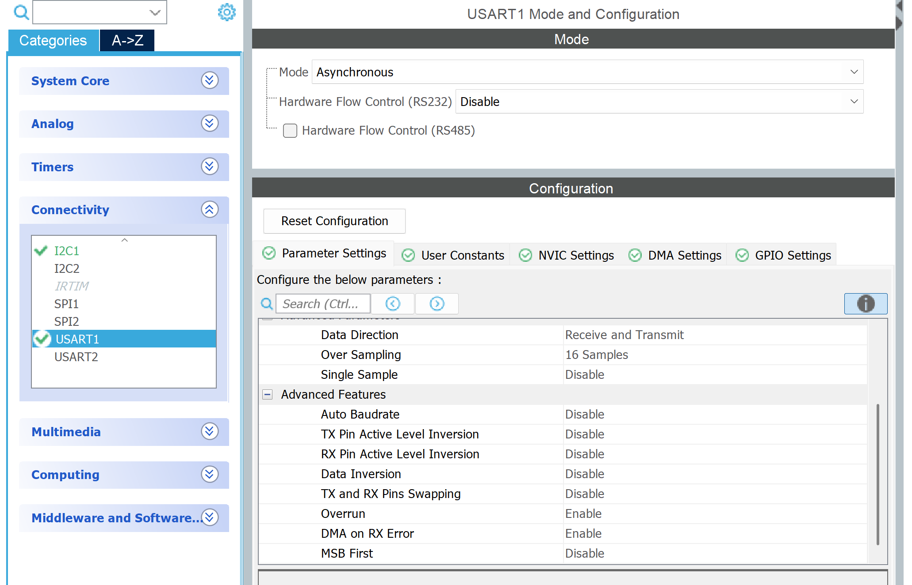
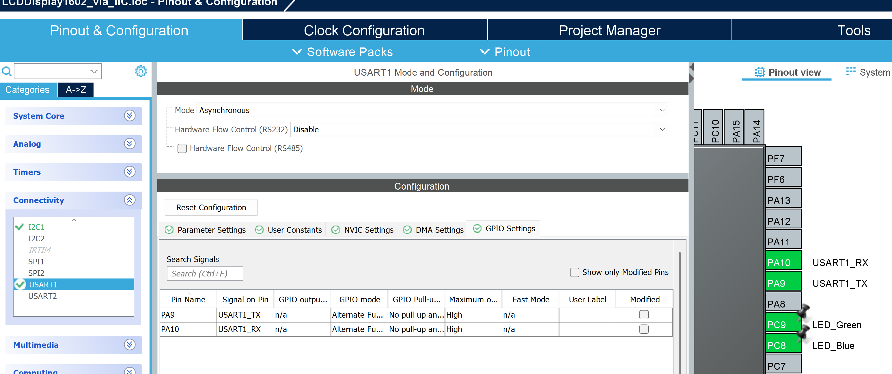
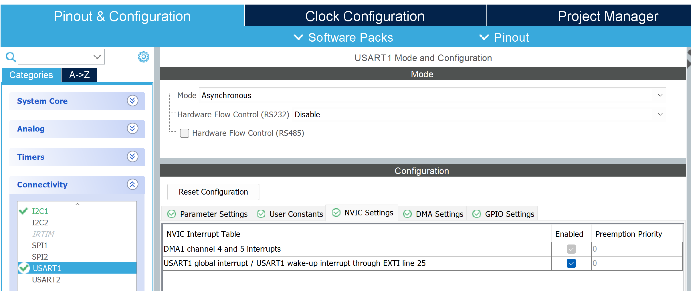
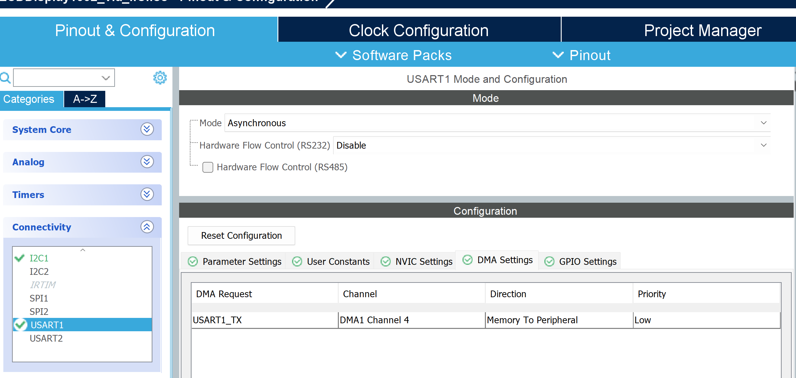

### I2C
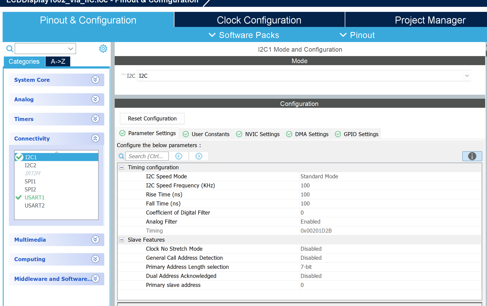
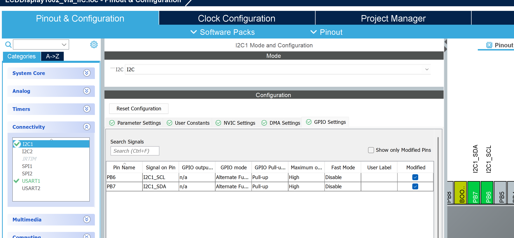
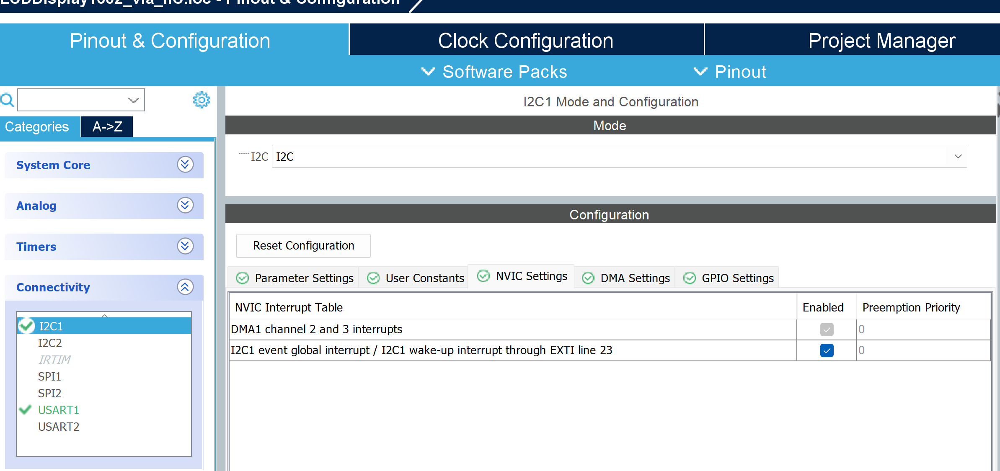
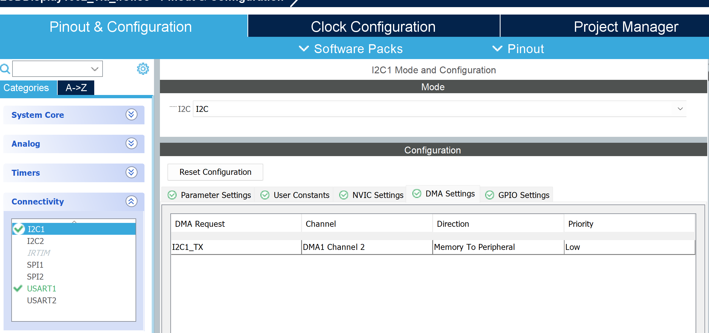

## Evidence
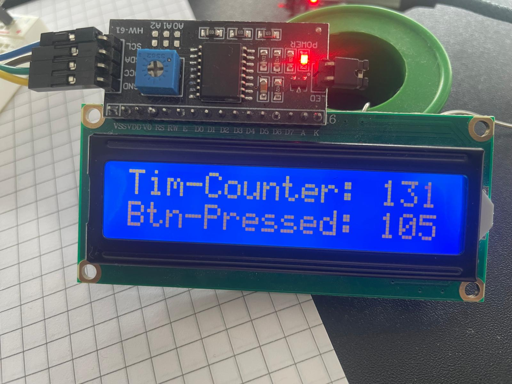
