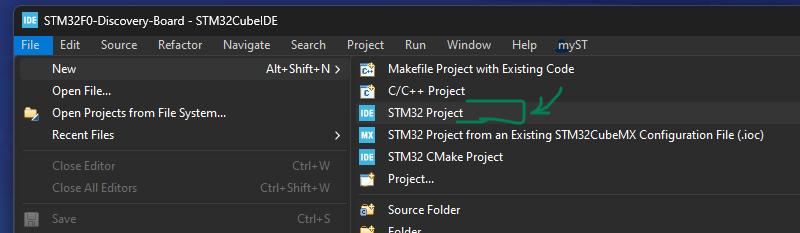
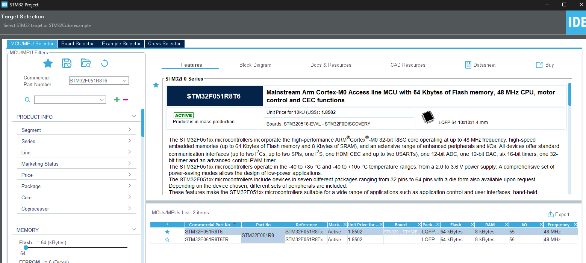
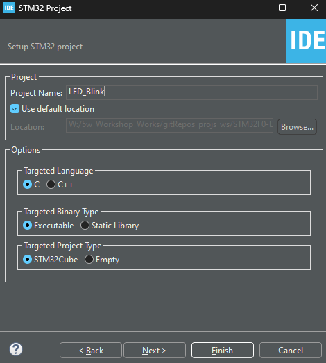
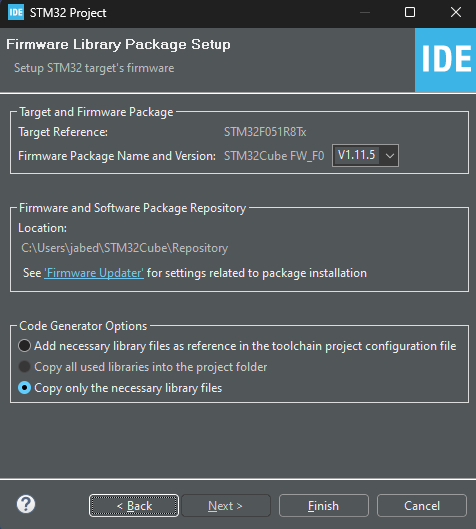
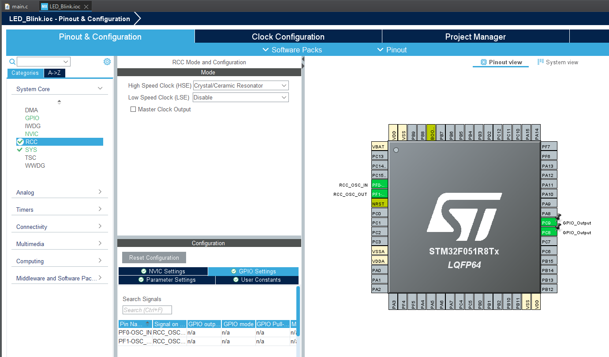
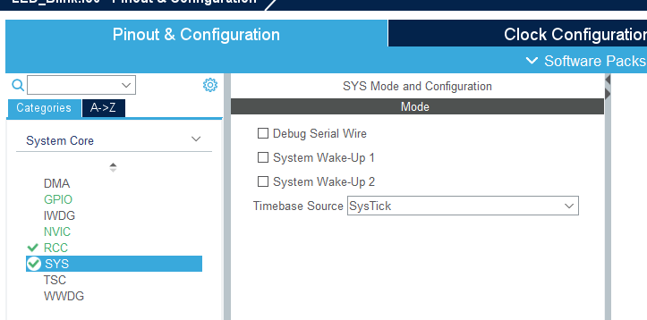
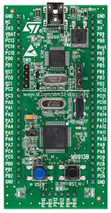

# STM32F0-Discovery-Board
### The repo contains Examples for STM32F0-Discovery-Board.

**Description:**
- Board code: STM32F0DISCOVERY
- MCU: STM32F051R8T6
- IDE used: STM32CubeIDE 1.16.0
- Driver:  
-> https://github.com/STMicroelectronics/STM32CubeF0 (v1.11.5)  
-> https://github.com/STMicroelectronics/STM32CubeF0/tree/master/Drivers
- - CMSIS: https://github.com/STMicroelectronics/STM32CubeF0/tree/master/Drivers/CMSIS
- - STM32F0xx_HAL_Driver: https://github.com/STMicroelectronics/stm32f0xx-hal-driver

### Projects:
| S.No. | Project                      | Short-Info              |
| ----- | ---------------------------- | ----------------------- |
| 1     | ADC                          | ...                     |
| 2     | DCMotor_Control              | ...                     |
| 3     | DHT11_TemperatureNHumidity   | ...                     |
| 4     | IIC_Master                   | ...                     |
| 5     | IIC_Slave                    | ...                     |
| 6     | LCDDisplay1602_via_IIC       | ...                     |
| 7     | LED_Blink                    | ...                     |
| 8     | LED_Blink_CMake              | STM32CubeIDE, and CMake |
| 9     | PushButton_EXTIInterrupt_LED | ...                     |
| 10    | Timer_InputCapture           | ...                     |
| 11    | Timer_PWM                    | ...                     |
| 12    | Timer_TIM6_DelayFun          | ...                     |
| 13    | Timer_TIM6_LEDBlink          | ...                     |
| 14    | UART                         | ...                     |
| 15    | UART_DMA                     | ...                     |

### How-To - An example

### STM32F0-Discovery-Board

